# 🏗️ TalkTranslo - Software Architecture Document

**System Version:** 2.4  
**Platform:** Flutter (Android & iOS)  
**Target SDK:** Flutter 3.6+ / Dart 3.6+  
**Design System:** Material 3 (M3)  
**Document Status:** Production Reference  

---

## 📑 Table of Contents
1. [Architectural Overview & Principles](#1-architectural-overview--principles)
2. [High-Level System Architecture](#2-high-level-system-architecture)
3. [Layer-by-Layer Breakdown](#3-layer-by-layer-breakdown)
   - [3.1 Presentation Layer (UI / UX)](#31-presentation-layer-ui--ux)
   - [3.2 State Management Layer (Provider)](#32-state-management-layer-provider)
   - [3.3 Domain & Service Layer](#33-domain--service-layer)
   - [3.4 Data & Local Persistence Layer](#34-data--local-persistence-layer)
4. [Key Architectural Mechanisms & Workflows](#4-key-architectural-mechanisms--workflows)
   - [4.1 3-Tier Resilient Translation Engine with Auto-Detect](#41-3-tier-resilient-translation-engine-with-auto-detect)
   - [4.2 Tabletop Face-to-Face 180° Inverted Conversation Pipeline](#42-tabletop-face-to-face-180-inverted-conversation-pipeline)
   - [4.3 Offline Survival Phrasebook & Dynamic Caching Engine](#43-offline-survival-phrasebook--dynamic-caching-engine)
   - [4.4 Fullscreen Traveler Presentation Mode](#44-fullscreen-traveler-presentation-mode)
   - [4.5 Clipboard Quick-Translate Pipeline](#45-clipboard-quick-translate-pipeline)
   - [4.6 Universal Voice, Pitch & Slow Pronunciation Modulation](#46-universal-voice-pitch--slow-pronunciation-modulation)
   - [4.7 Real-Time Audio Waveform & Decibel Streaming](#47-real-time-audio-waveform--decibel-streaming)
   - [4.8 OCR Text Isolation & Cropping Pipeline](#48-ocr-text-isolation--cropping-pipeline)
5. [Database Schema & Data Models](#5-database-schema--data-models)
6. [Platform Integration & Manifest Configurations](#6-platform-integration--manifest-configurations)
7. [Testing Strategy & Quality Assurance](#7-testing-strategy--quality-assurance)
8. [File Structure & Component Directory Map](#8-file-structure--component-directory-map)

---

## 1. Architectural Overview & Principles

**TalkTranslo** is an offline-resilient, multilingual translation and conversation utility built with Flutter. The architectural structure is governed by core software engineering principles:

- **Separation of Concerns (SoC):** Clean boundaries separating presentation widgets, reactive state providers, domain business services, and database persistence layers.
- **Offline Resilience & Graceful Degradation:** The translation engine implements automatic 3-tier fallback chains and local phrasebook matching to ensure that critical communication succeeds even during total network blackouts.
- **Ergonomic Hardware Interaction:** Support for tabletop face-to-face dialogue where top half rotates 180° (`RotatedBox(quarterTurns: 2)`) with in-card microphones facing the opposite speaker.
- **Reactive State Without Render Waste:** High-frequency events (e.g., 60 FPS audio waveform decibel streams) are isolated using dedicated `ValueNotifier` patterns to avoid rebuilding widget subtrees.
- **State Preservation Across Navigation:** Screen state across all 4 operational tabs is maintained using `IndexedStack` and top-level providers, preventing data loss during navigation.
- **Clean Theming & Material 3 Alignment:** Strictly adheres to Material 3 design specs, dynamic color schemes, semantic contrast, and light/dark theme persistence.

---

## 2. High-Level System Architecture

```mermaid
flowchart TD
    subgraph Presentation ["Presentation Layer (Flutter UI)"]
        UI_Shell["HomeScreen (IndexedStack + M3 NavigationBar)"]
        UI_Trans["TranslateScreen (Clipboard Banner, Offline Handler)"]
        UI_Speech["SpeechScreen (Face-to-Face 180° Invert Mode)"]
        UI_OCR["ImageTextScreen (OCR & Cropping)"]
        UI_Hist["HistoryScreen (3-Way Hub: History, Saved, Phrasebook)"]
        UI_Phrase["PhrasebookScreen & PhrasebookView"]
        UI_Full["FullscreenTextScreen (Traveler Flashcard)"]
        UI_Settings["SettingScreen & SpeechSettingScreen"]
        UI_Widgets["Reusable Components (TextCard, AudioWaveform, CustomDropdown)"]
    end

    subgraph StateManagement ["State Management Layer (Provider)"]
        P_Trans["TranslationProvider (Auto-Detect, Speech & Audio)"]
        P_Hist["HistoryProvider (CRUD, Favorites, Export)"]
        P_OCR["ImageTextProvider (OCR & Image Isolation)"]
        P_Theme["ThemeProvider (M3 Dark/Light Persistence)"]
    end

    subgraph DomainServices ["Domain & Services Layer"]
        S_Trans["TranslationService (3-Tier Engine + Auto-Detect)"]
        S_Speech["SpeechService (STT, TTS, Slow 0.52x, Locales)"]
        S_OCR["TextRecognitionService (Google ML Kit)"]
        S_DB["DatabaseService (SQLite Helper)"]
        D_Data["PhrasebookData (34 Survival Phrases & Offline Bundles)"]
    end

    subgraph ExternalPlatforms ["Platform & External Engines"]
        E_TransPkg["translator (Primary)"]
        E_GTX["Google GTX Single API (Fallback 1)"]
        E_Dict["Chrome Dict API (Fallback 2)"]
        E_STT["SpeechToText Native Engine"]
        E_TTS["FlutterTts Platform Engine"]
        E_MLKit["Google ML Kit Vision SDK"]
        E_SQLite["SQLite DB (sqflite)"]
        E_Prefs["SharedPreferences (Storage)"]
        E_Share["share_plus (Export Sheet)"]
    end

    UI_Shell --> UI_Trans & UI_Speech & UI_OCR & UI_Hist & UI_Settings
    UI_Trans --> UI_Full & UI_Phrase & P_Trans
    UI_Speech --> P_Trans
    UI_Hist --> UI_Phrase & P_Hist & E_Share
    UI_OCR --> P_OCR
    UI_Settings --> P_Theme & P_Trans

    P_Trans --> S_Trans & S_Speech & S_DB & D_Data
    P_Hist --> S_DB & E_Share
    P_OCR --> S_OCR & S_Trans
    P_Theme --> E_Prefs

    S_Trans --> E_TransPkg & E_GTX & E_Dict
    S_Speech --> E_STT & E_TTS
    S_OCR --> E_MLKit
    S_DB --> E_SQLite
```



---

## 3. Layer-by-Layer Breakdown

### 3.1 Presentation Layer (UI / UX)
- **Shell (`HomeScreen`):** Manages a 4-destination `NavigationBar` containing `IndexedStack` to preserve scroll offsets and user inputs.
- **Translate (`TranslateScreen`):** Handles text translation, **Auto-Detect Language ✨**, clipboard auto-paste pill, slow pronunciation mode (`🐢`), offline phrasebook fallback matching, and fullscreen flashcards.
- **Voice Conversation (`SpeechScreen`):** Implements dual conversation cards with tabletop **Face-to-Face 180° Invert Mode** (`RotatedBox(quarterTurns: 2)`), in-card microphones with `AvatarGlow`, dynamic active borders, and central divider controls.
- **Image OCR (`ImageTextScreen`):** Supports camera and gallery image capture, aspect ratio cropping (`image_cropper`), multi-script text recognition, and translation.
- **History Hub (`HistoryScreen`):** 3-way segmented hub toggling between `All`, `Saved`, and embedded `PhrasebookView`, with plain text and CSV export actions.
- **Travel Phrasebook (`PhrasebookScreen`):** Categorized offline survival phrases with search bar, target language selector, in-memory caching, audio playback, and fullscreen mode.
- **Fullscreen Flashcard (`FullscreenTextScreen`):** Giant high-contrast scaling text screen designed for showing drivers, store clerks, or passersby across counters.

### 3.2 State Management Layer (Provider)
- **`TranslationProvider`:** Orchestrates input/output text controllers, active speaker state, decibel sound levels (`ValueNotifier<double> soundLevelNotifier`), voice dictation, speech translation, and persistent settings.
- **`HistoryProvider`:** Manages translation history records, search query filtering, favorite toggles, and deletion confirmations.
- **`ImageTextProvider`:** Manages scanned image states, OCR extraction lifecycles, and translation pipelines.
- **`ThemeProvider`:** Manages Material 3 brightness and theme persistence.

### 3.3 Domain & Services Layer
- **`TranslationService`:** 3-tier resilient engine handling auto-detection (`from: 'auto'`, `sl=auto`) across primary and backup endpoints.
- **`SpeechService`:** Interfaces with `speech_to_text` for voice recognition and `flutter_tts` for audio synthesis with support for gendered voice profiles, pitch modulation, and slow pronunciation (`isSlow: true` @ 0.52x rate).
- **`DatabaseService`:** SQLite database wrapper handling schema creation, CRUD operations, and indexed queries.
- **`PhrasebookData`:** Static data repository providing 34 curated phrases across 5 categories and bundled offline translations for zero-connectivity situations.

---

## 4. Key Architectural Mechanisms & Workflows

### 4.1 3-Tier Resilient Translation Engine with Auto-Detect
Requests are routed through a waterfall failover pipeline:
1. **Tier 1:** `translator` package (`from: sourceCode`, `to: targetCode`).
2. **Tier 2 (Fallback 1):** Direct HTTP request to Google GTX Single API (`https://translate.googleapis.com/translate_a/single?client=gtx&sl=$sourceCode&tl=$targetCode&dt=t&q=$encodedText`).
3. **Tier 3 (Fallback 2):** Chrome Dictionary Client API (`https://clients5.google.com/translate_a/t?client=dict-chrome-ex&sl=$sourceCode&tl=$targetCode&q=$encodedText`).
4. **Auto-Detect Support:** When source is `'auto'`, the engine passes `sl=auto` to the API. Language swapping is safely guarded against swapping into an auto-detect target.

### 4.2 Tabletop Face-to-Face 180° Inverted Conversation Pipeline
When two people sit opposite each other across a table or counter:
1. User activates **Face-to-Face Mode** via the toolbar.
2. Speaker 1's card is rotated 180° (`RotatedBox(quarterTurns: 2)`), inverting text, language badge, and audio actions for the opposite speaker.
3. Dedicated in-card pulsing `AvatarGlow` microphones and real-time waveforms appear directly inside each speaker's card at their thumb's reach.
4. The bottom floating dock automatically hides to maximize vertical reading area.
5. A central divider strip provides an instant language swap button (`swapLanguages`), mode toggle pill, and conversation reset action.

### 4.3 Offline Survival Phrasebook & Dynamic Caching Engine
1. **Offline Match:** When an input phrase matches any of the 34 offline survival phrases (e.g., *"Help! Call the police"*, *"Where is the bathroom"*), TalkTranslo retrieves the pre-bundled translation instantly without making network requests.
2. **Dynamic In-Memory Caching:** When phrases are translated into any of the 60+ supported languages, translations are stored in `_translationCache["${phraseId}_$targetLang"]`, guaranteeing zero re-fetch overhead and immediate offline availability.
3. **Graceful Offline Status Banner:** If an unknown phrase fails due to network outage, an offline banner is presented with a 1-tap `[ Phrasebook 📖 ]` action button.

### 4.4 Fullscreen Traveler Presentation Mode
- Dynamically scales font size (28sp to 46sp) based on text length to fill the display.
- High-contrast typography optimized for readability across counters or through vehicle partitions.
- Includes quick-access audio pronunciation, one-tap clipboard copy, and language flag badge.

### 4.5 Clipboard Quick-Translate Pipeline
1. On screen initialization or app resume, `TranslateScreen` checks `Clipboard.getData(Clipboard.kTextPlain)`.
2. If non-empty copied text exists (between 2 and 400 characters) and differs from the current input, a dismissible pill is displayed: `[ 📋 Translate copied text: "..." ➔ ]`.
3. Tapping the pill populates the input controller and triggers translation immediately with haptic feedback.

### 4.6 Universal Voice, Pitch & Slow Pronunciation Modulation
- **Natural / Male / Female / Robot Profiles:** Modulates base pitch and speech rate multiplier.
- **Slow Pronunciation Mode (🐢 0.6x):** When `isSlow: true` is requested, `effectiveRate` is set to `0.52`, allowing language learners and travelers to hear native phonetics enunciated slowly.
- **Dynamic BCP-47 Resolution:** Automatically resolves language codes to valid platform TTS voice tags (e.g. `kn-IN`, `hi-IN`, `es-ES`).

---

## 5. Database Schema & Data Models

### Translation History Table (`translations`)
```sql
CREATE TABLE translations(
  id INTEGER PRIMARY KEY AUTOINCREMENT,
  source_text TEXT NOT NULL,
  translated_text TEXT NOT NULL,
  source_lang TEXT NOT NULL,
  target_lang TEXT NOT NULL,
  timestamp INTEGER NOT NULL,
  is_favorite INTEGER DEFAULT 0
);
```

---

## 6. Testing Strategy & Quality Assurance

TalkTranslo maintains automated test coverage across unit, widget, and live service tests:

| Test File | Target Module | Scope |
|---|---|---|
| `test/audio_waveform_test.dart` | `AudioWaveform` | Verifies resting state and active multi-bar animations upon decibel stream updates. |
| `test/history_model_test.dart` | `TranslationHistoryItem` | Verifies SQLite serialization (`toMap`, `fromMap`) and immutability via `copyWith`. |
| `test/preferences_persistence_test.dart` | `ThemeProvider`, `TranslationProvider` | Verifies settings serialization and persistence across simulated app restarts. |
| `test/speech_utils_test.dart` | `language.dart` utilities | Validates BCP-47 locale resolution (`getTtsLocale`) and voice normalizations. |
| `test/speech_screen_test.dart` | `SpeechScreen` | Verifies 180° Face-to-Face rotation, in-card microphones, and central divider toolbar. |
| `test/phrasebook_test.dart` | `PhrasebookScreen` & `PhrasebookView` | Tests survival phrase data, category filtering, search, and History tab switching. |
| `test/translation_service_test.dart` | `TranslationService` | Live integration tests translating across English, Kannada, Hindi, and Spanish with Auto-Detect. |
| `test/widget_test.dart` | App Shell (`MyApp`) | Smoke test verifying startup initialization and welcome screen rendering. |

---

## 7. File Structure & Component Directory Map

```
lib/
├── main.dart                          # App initialization & MultiProvider registration
├── data/                              # Static & Curated Data
│   └── phrasebook_data.dart           # 34 survival phrases, categories & offline translations
├── models/                            # Data transfer objects
│   └── history_item.dart              # Translation history & phrasebook model
├── screens/                           # Presentation layer screens
│   ├── home_screen.dart              # M3 NavigationBar shell with IndexedStack
│   ├── translate_screen.dart         # Text translation, clipboard banner, offline fallback
│   ├── speech_screen.dart            # Two-way split-screen & 180° Face-to-Face voice mode
│   ├── imagetext_screen.dart         # ML Kit camera/gallery OCR & cropping
│   ├── history_screen.dart           # 3-way hub: History, Saved phrases & Phrasebook
│   ├── phrasebook_screen.dart        # Standalone & embedded Travel Phrasebook view
│   ├── fullscreen_text_screen.dart   # High-contrast fullscreen flashcard display
│   ├── setting_screen.dart           # Appearance, voice settings & app info
│   ├── speechsetting_screen.dart     # Pitch, speed, voice models & preview test
│   ├── abouthelp_screen.dart         # Expandable FAQs & support information
│   └── welcome_screen.dart           # First-launch onboarding splash
├── provider/                          # State management (ChangeNotifiers)
│   ├── translator_provider.dart      # Translation, speech orchestration & audio streams
│   ├── history_provider.dart         # SQLite history & starred state
│   ├── image_text_provider.dart      # OCR recognition & cropping pipeline
│   └── theme_provider.dart           # Theme mode management & persistence
├── services/                          # Domain & business logic
│   ├── translator_service.dart       # 3-tier resilient translation engine (with Auto-Detect)
│   ├── database_service.dart         # SQLite CRUD & schema helper
│   ├── speech_service.dart           # STT, TTS (with slow 0.52x mode) & voice styles
│   └── text_recognition_service.dart # Google ML Kit on-device recognizer
├── component/                         # Reusable UI widgets
│   ├── audio_waveform.dart           # Live decibel-reactive audio waveform visualizer
│   ├── text_card.dart                # M3 card with selectable text, toolbar & slow audio
│   ├── custom_dropdown.dart          # Search modal bottom sheet with national flags
│   ├── dialog.dart                   # Language modal dialogs
│   ├── elevation_button.dart         # Standardized elevated button
│   └── ripple_iconbutton.dart        # Ripple feedback button
└── utils/                             # Constants & system configuration
    ├── constant.dart                 # App constants & metadata
    ├── language.dart                 # Language codes, BCP-47 tags, and flag mappings
    └── theme.dart                    # Material 3 light and dark theme configurations
```

---

## 8. Release Engineering & Production Deployment

TalkTranslo is configured for secure, optimized production distribution on the Google Play Store:

| Configuration | Setting / Path | Purpose |
|---|---|---|
| **Android Application ID** | `com.talktranslo.app` | Unique production package identifier replacing default `com.example`. |
| **Android Namespace** | `com.talktranslo.app` | AGP 8+ Gradle namespace in [android/app/build.gradle](file:///D:/Learning/flutterapps/talktranslo/android/app/build.gradle). |
| **App Title** | `TalkTranslo` | Manifest user-facing label in [AndroidManifest.xml](file:///D:/Learning/flutterapps/talktranslo/android/app/src/main/AndroidManifest.xml). |
| **R8 Code Shrinker** | `minifyEnabled true` | Removes unused classes, methods, and dead code from release builds. |
| **Resource Shrinker** | `shrinkResources true` | Strips unused drawable, layout, and string assets during packaging. |
| **ProGuard Rules** | [android/app/proguard-rules.pro](file:///D:/Learning/flutterapps/talktranslo/android/app/proguard-rules.pro) | Preserves reflection and JNI symbols for ML Kit OCR, Flutter TTS, STT, and SQLite. |
| **Global Error Boundary** | `PlatformDispatcher.instance.onError` | Intercepts asynchronous platform errors preventing application crashes. |
| **Release Artifact** | `build/app/outputs/flutter-apk/app-release.apk` | Self-contained, optimized release binary (85.4 MB with embedded offline models). |
