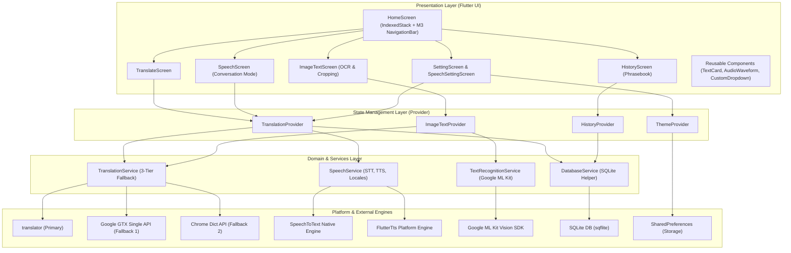
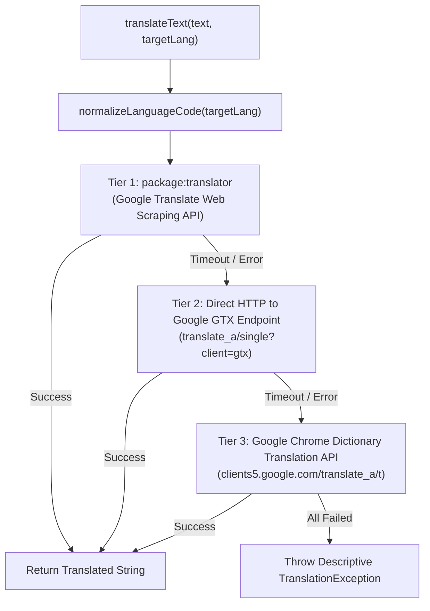
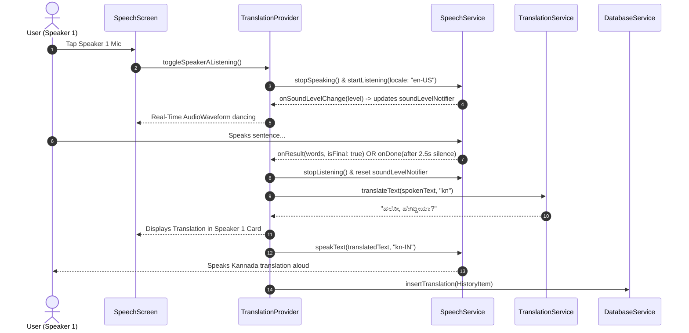
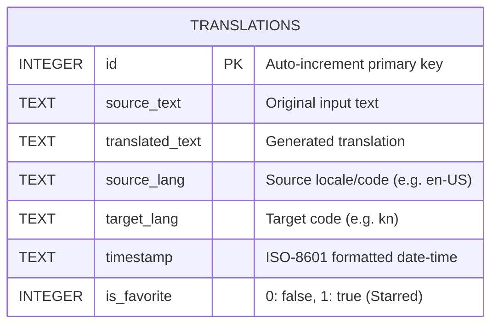

# 🏗️ TalkTranslo - Software Architecture Document

**System Version:** 2.2  
**Platform:** Flutter (Android & iOS)  
**Target SDK:** Flutter 3.6+ / Dart 3.6+  
**Design System:** Material 3 (M3)  
**Document Status:** Production Reference  

---

## 📑 Table of Contents
1. [Architectural Overview & Principles](#1-architectural-overview--principles)
2. [High-Level System Architecture](#2-high-level-system-architecture)
3. [Layer-by-Layer Breakdown](#3-layer-by-layer-breakdown)
   - [3.1 Presentation Layer (UI / UX)](#31-presentation-layer-ui--ux)
   - [3.2 State Management Layer (Provider)](#32-state-management-layer-provider)
   - [3.3 Domain & Service Layer](#33-domain--service-layer)
   - [3.4 Data & Local Persistence Layer](#34-data--local-persistence-layer)
4. [Key Architectural Mechanisms & Workflows](#4-key-architectural-mechanisms--workflows)
   - [4.1 3-Tier Resilient Translation Engine](#41-3-tier-resilient-translation-engine)
   - [4.2 Two-Way Split-Screen Voice Conversation Pipeline](#42-two-way-split-screen-voice-conversation-pipeline)
   - [4.3 Real-Time Audio Waveform & Decibel Streaming](#43-real-time-audio-waveform--decibel-streaming)
   - [4.4 Universal Voice & Timbre Adaptation (TTS)](#44-universal-voice--timbre-adaptation-tts)
   - [4.5 OCR Text Isolation & Cropping Pipeline](#45-ocr-text-isolation--cropping-pipeline)
5. [Database Schema & Data Models](#5-database-schema--data-models)
6. [Platform Integration & Manifest Configurations](#6-platform-integration--manifest-configurations)
7. [Testing Strategy & Quality Assurance](#7-testing-strategy--quality-assurance)
8. [File Structure & Component Directory Map](#8-file-structure--component-directory-map)

---

## 1. Architectural Overview & Principles

**TalkTranslo** is an offline-resilient, multilingual translation and conversation utility built with Flutter. The architectural structure is governed by core software engineering principles:

- **Separation of Concerns (SoC):** Distinct separation between the UI widgets, state providers, platform business services, and database persistence layers.
- **Resilience & Graceful Degradation:** The translation engine implements automatic 3-tier fallback chains to ensure translation requests succeed even during network fluctuations or API rate-limiting.
- **Reactive State Without Render Waste:** High-frequency events (e.g., 60 FPS audio waveform decibel streams) are isolated using dedicated `ValueNotifier` patterns to avoid rebuilding widget subtrees.
- **State Preservation Across Navigation:** Screen state across all 4 operational tabs is maintained using `IndexedStack` and top-level providers, preventing data loss during navigation.
- **Clean Theming & Material 3 Alignment:** Strictly adheres to Material 3 design specs, dynamic color schemes, semantic contrast, and light/dark theme persistence.

---

## 2. High-Level System Architecture



---

## 3. Layer-by-Layer Breakdown

### 3.1 Presentation Layer (UI / UX)
The presentation layer manages user interactions, input capture, and visual feedback:

- **`HomeScreen` (`lib/screens/home_screen.dart`):**  
  Acts as the application shell. Houses the Material 3 `NavigationBar` and coordinates tab switching via an `IndexedStack`. When transitioning between tabs, it automatically triggers `TranslationProvider.stopAllSpeechAndListening()` to clean up background microphones or audio playback.
- **`TranslateScreen` (`lib/screens/translate_screen.dart`):**  
  Primary text translation interface. Supports language selection with country flags, animated 180° language swapping, live character counting, and action toolbars (Copy, Paste, Clear, Speak, Share, Star).
- **`SpeechScreen` (`lib/screens/speech_screen.dart`):**  
  Dual split-screen conversation mode. Allocates dedicated top/bottom cards for Speaker 1 and Speaker 2. Includes a floating thumb-friendly dual-mic dock and integrated real-time audio waveforms.
- **`ImageTextScreen` (`lib/screens/imagetext_screen.dart`):**  
  Camera and Gallery OCR scanning with integrated cropping. Features a floating "Crop / Rotate" overlay button, multi-script selector, and instant OCR-to-translation pipeline with audio pronunciation.
- **`HistoryScreen` (`lib/screens/history_screen.dart`):**  
  Searchable SQLite translation log and starred phrasebook. Provides segmented filter chips ("All" vs "Starred"), swipe-to-delete with an immediate undo SnackBar, native sharing via `share_plus`, and audio replay.
- **Reusable Components (`lib/component/`):**
  - `TextCard`: Card with `SelectableText`, action toolbars, and compact spacing.
  - `AudioWaveform`: Decibel-reactive multi-bar fluid waveform.
  - `CustomDropdown`: Search modal bottom sheet with national flag emojis.

### 3.2 State Management Layer (Provider)
State management follows the **Provider** pattern (`ChangeNotifier`) for decoupled reactivity:

| Provider | File | Responsibilities |
|---|---|---|
| **`TranslationProvider`** | [`translator_provider.dart`](file:///D:/Learning/flutterapps/talktranslo/lib/provider/translator_provider.dart) | Manages source/target language codes, active text controllers, two-way conversation turn-taking, speech state, voice pitch/rate settings, and high-frequency `soundLevelNotifier`. |
| **`HistoryProvider`** | [`history_provider.dart`](file:///D:/Learning/flutterapps/talktranslo/lib/provider/history_provider.dart) | Handles SQLite interaction, in-memory history caching, real-time query filtering, item restoration (Undo), and phrasebook star toggling. |
| **`ImageTextProvider`** | [`image_text_provider.dart`](file:///D:/Learning/flutterapps/talktranslo/lib/provider/image_text_provider.dart) | Controls image capture, native cropper invocation, ML Kit OCR recognition status, and scanned text state across tab transitions. |
| **`ThemeProvider`** | [`theme_provider.dart`](file:///D:/Learning/flutterapps/talktranslo/lib/provider/theme_provider.dart) | Manages dark/light theme switching and persists preference to `SharedPreferences`. |

### 3.3 Domain & Service Layer
Encapsulates platform channels, hardware APIs, and business rules:

- **`TranslationService` (`lib/services/translator_service.dart`):**  
  Handles multi-language text translation. Implements language normalization (e.g., mapping regional locales `kn-IN`, `zh-CN` to engine codes) and executes multi-tier failovers.
- **`SpeechService` (`lib/services/speech_service.dart`):**  
  Coordinates hardware Speech-to-Text (`speech_to_text`) and Text-to-Speech (`flutter_tts`). Handles dynamic STT locale resolution, silence detection parameters, BCP-47 locale formatting, and native voice discovery.
- **`DatabaseService` (`lib/services/database_service.dart`):**  
  Manages SQLite database creation, schema upgrades, indexed queries, and duplicate record management.
- **`TextRecognitionService` (`lib/services/text_recognition_service.dart`):**  
  On-device ML Kit OCR across Latin, Devanagari, Chinese, Japanese, and Korean scripts.

### 3.4 Data & Local Persistence Layer
Combines lightweight key-value storage with a structured relational database:

- **Key-Value Persistence (`SharedPreferences`):**  
  Stores user settings: theme mode (`is_dark_mode`), speech rate (`pref_speech_rate`), voice pitch (`pref_pitch`), voice model (`pref_selected_voice`), and default language pairs.
- **Relational Storage (`sqflite`):**  
  Stores translation history and favorited phrasebook entries locally on the device disk with indexed lookups.

---

## 4. Key Architectural Mechanisms & Workflows

### 4.1 3-Tier Resilient Translation Engine

To avoid network failures or API quota blockages, translation requests pass through a 3-tier resilient cascade:



> [!NOTE]
> All outbound requests enforce an 8-second network timeout. If a higher tier throws an error, the service gracefully cascades to the next tier without throwing exceptions to the UI.

---

### 4.2 Two-Way Split-Screen Voice Conversation Pipeline

The conversation pipeline orchestrates microphone listening, auto-silence finalization, multi-tier translation, and immediate audio pronunciation:



---

### 4.3 Real-Time Audio Waveform & Decibel Streaming

To achieve 60 FPS animation without triggering expensive widget tree rebuilds:

```
Microphone Hardware (Buffer)
      │
      ▼
SpeechToText.onSoundLevelChange(level: -2dB to 10+dB)
      │
      ▼
TranslationProvider._handleSoundLevelChange()
      │ (Normalizes level to 0.0 - 1.0 range)
      ▼
ValueNotifier<double> soundLevelNotifier.value = normalized
      │
      ▼ (ValueListenableBuilder - Rebuilds ONLY AudioWaveform)
AudioWaveform Custom State
      │
      ▼ [Combines soundLevel + Sinusoidal Wave Oscillation]
7-Bar Symmetric Gaussian Curve: barHeight = (min + span * level * sin(factor))
```

---

### 4.4 Universal Voice & Timbre Adaptation (TTS)

The speech engine ensures high-quality speech output across all supported languages (including Indic scripts) without breaking when native platform voices are missing:

```
Requested Language + Voice Type ('male', 'female', 'robot', 'natural')
      │
      ├── 1. Locale Resolution: getTtsLocale() maps 'kn' -> 'kn-IN', 'hi' -> 'hi-IN'
      │
      ├── 2. Platform Voice Discovery: flutter_tts.getVoices queries native voices
      │      • Checks if installed voice matches locale + requested gender tag
      │      • If found: flutter_tts.setVoice(matchingVoice)
      │
      └── 3. Acoustic Pitch & Rate Modulation (Universal Fallback):
             • Male: pitch * 0.82 (deeper masculine resonance), rate * 0.96
             • Female: pitch * 1.25 (clear feminine formant), normal rate
             • Robot: pitch * 0.65 (monotone mechanical timbre), rate * 0.85
```

---

### 4.5 OCR Text Isolation & Cropping Pipeline

```
Image Captured (Camera / Gallery)
      │
      ▼
Saved to temporary disk cache (XFile)
      │
      ▼
User taps 'Crop / Rotate'
      │
      ▼
ImageCropper.cropImage()
      │ (Native UCropActivity on Android / TOCropViewController on iOS)
      ▼
Cropped XFile generated
      │
      ▼
TextRecognitionService.recognizeTextFromImage(croppedFile, script)
      │ (Google ML Kit on-device model)
      ▼
Recognized Text -> TranslationService -> UI Output + TTS Replay
```

---

## 5. Database Schema & Data Models

The local database (`talktranslo.db`) is managed via SQLite (`sqflite`).

### Entity-Relationship Diagram



### Database Indexes
For real-time search and query performance, the following indexes are maintained:
```sql
CREATE INDEX idx_translations_timestamp ON translations(timestamp DESC);
CREATE INDEX idx_translations_favorite ON translations(is_favorite);
```

### Deduplication Strategy
When a translation is executed:
- The database checks if a record with matching `source_text` and `translated_text` already exists.
- If it exists, the database updates the `timestamp` to `DateTime.now()` rather than creating duplicate entries.

---

## 6. Platform Integration & Manifest Configurations

### Android (`android/app/src/main/AndroidManifest.xml`)
- **Hardware Permissions:**
  ```xml
  <uses-permission android:name="android.permission.RECORD_AUDIO"/>
  <uses-permission android:name="android.permission.INTERNET"/>
  <uses-permission android:name="android.permission.CAMERA"/>
  ```
- **Android 11+ Package Visibility (`<queries>`):**
  Required for detecting system Speech Recognition and TTS engines:
  ```xml
  <queries>
      <intent><action android:name="android.speech.RecognitionService"/></intent>
      <intent><action android:name="android.intent.action.TTS_SERVICE"/></intent>
  </queries>
  ```
- **Image Cropper Native Activity:**
  ```xml
  <activity
      android:name="com.yalantis.ucrop.UCropActivity"
      android:screenOrientation="portrait"
      android:theme="@style/Theme.AppCompat.Light.NoActionBar"/>
  ```

### iOS (`ios/Runner/Info.plist`)
- `NSMicrophoneUsageDescription`: Microphone access for conversational voice mode.
- `NSSpeechRecognitionUsageDescription`: Speech recognition for transcribing spoken phrases.
- `NSCameraUsageDescription`: Camera access for capturing text for OCR.
- `NSPhotoLibraryUsageDescription`: Photo gallery access to import images for text extraction.

---

## 7. Testing Strategy & Quality Assurance

The codebase maintains automated test coverage across unit, widget, and live service tests:

| Test File | Target Module | Scope |
|---|---|---|
| [`test/audio_waveform_test.dart`](file:///D:/Learning/flutterapps/talktranslo/test/audio_waveform_test.dart) | `AudioWaveform` | Verifies resting state and active multi-bar animations upon decibel stream updates. |
| [`test/history_model_test.dart`](file:///D:/Learning/flutterapps/talktranslo/test/history_model_test.dart) | `TranslationHistoryItem` | Verifies SQLite serialization (`toMap`, `fromMap`) and immutability via `copyWith`. |
| [`test/preferences_persistence_test.dart`](file:///D:/Learning/flutterapps/talktranslo/test/preferences_persistence_test.dart) | `ThemeProvider`, `TranslationProvider` | Verifies settings serialization and persistence across simulated app restarts. |
| [`test/speech_utils_test.dart`](file:///D:/Learning/flutterapps/talktranslo/test/speech_utils_test.dart) | `language.dart` utilities | Validates BCP-47 locale resolution (`getTtsLocale`) and voice normalizations. |
| [`test/translation_service_test.dart`](file:///D:/Learning/flutterapps/talktranslo/test/translation_service_test.dart) | `TranslationService` | Live integration tests translating across English, Kannada, Hindi, and Spanish. |
| [`test/widget_test.dart`](file:///D:/Learning/flutterapps/talktranslo/test/widget_test.dart) | App Shell (`MyApp`) | Smoke test verifying startup initialization and welcome screen rendering. |

---

## 8. File Structure & Component Directory Map

```
lib/
├── main.dart                          # App initialization & MultiProvider registration
├── models/                            # Data transfer objects
│   └── history_item.dart              # Translation history & phrasebook model
├── screens/                           # Presentation layer screens
│   ├── home_screen.dart              # M3 NavigationBar shell with IndexedStack
│   ├── translate_screen.dart         # Text translation with animated swap & toolbars
│   ├── speech_screen.dart            # Two-way split-screen conversational voice mode
│   ├── imagetext_screen.dart         # ML Kit camera/gallery OCR & cropping
│   ├── history_screen.dart           # Searchable history & starred phrasebook
│   ├── setting_screen.dart           # Appearance, voice settings & app info
│   ├── speechsetting_screen.dart     # Pitch, speed, voice models & preview test
│   ├── abouthelp_screen.dart         # Expandable FAQs & support information
│   └── welcome_screen.dart           # First-launch onboarding splash
├── provider/                          # State management (ChangeNotifiers)
│   ├── translator_provider.dart      # Translation, speech orchestration & audio streams
│   ├── history_provider.dart         # SQLite history & starred state
│   ├── image_text_provider.dart      # OCR recognition & cropping pipeline
│   └── theme_provider.dart           # Theme mode management & persistence
├── services/                          # Domain & business logic
│   ├── translator_service.dart       # 3-tier resilient translation engine
│   ├── database_service.dart         # SQLite CRUD & schema helper
│   ├── speech_service.dart           # Speech-to-Text & Text-to-Speech platform service
│   └── text_recognition_service.dart # Google ML Kit on-device recognizer
├── component/                         # Reusable UI widgets
│   ├── audio_waveform.dart           # Live decibel-reactive audio waveform visualizer
│   ├── text_card.dart                # M3 card with selectable text & action toolbar
│   ├── custom_dropdown.dart          # Search modal bottom sheet with national flags
│   ├── dialog.dart                   # Language modal dialogs
│   ├── elevation_button.dart         # Standardized elevated button
│   └── ripple_iconbutton.dart        # Ripple feedback button
└── utils/                             # Constants & system configuration
    ├── constant.dart                 # App constants & metadata
    ├── language.dart                 # Language codes, BCP-47 tags, and flag mappings
    └── theme.dart                    # Material 3 light and dark theme configurations
```
