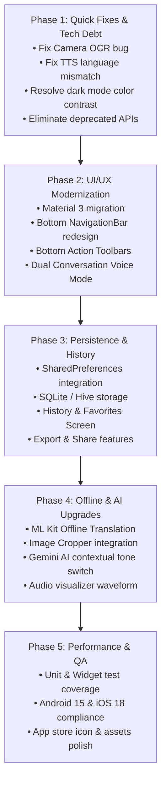

# 🗺️ TalkTranslo - Project Upgrade & Future Roadmap

**Document Version:** 2.0  
**Target Platform:** Flutter (Android & iOS)  
**Last Audit Date:** November 2026  

---

## 📑 Table of Contents
1. [Executive Audit & Current State Analysis](#1-executive-audit--current-state-analysis)
2. [Critical Bug Fixes & Technical Debt (Immediate)](#2-critical-bug-fixes--technical-debt-immediate)
3. [UI / UX ("YI") Modernization & Redesign](#3-ui--ux-yi-modernization--redesign)
4. [Functional Upgrades & New Features](#4-functional-upgrades--new-features)
5. [Architecture & State Management Refactoring](#5-architecture--state-management-refactoring)
6. [Dependency & Platform Upgrade Strategy](#6-dependency--platform-upgrade-strategy)
7. [Step-by-Step Implementation Phases](#7-step-by-step-implementation-phases)

---

## 1. Executive Audit & Current State Analysis

An in-depth analysis of the **TalkTranslo** codebase revealed a functional foundation with significant opportunities for modernization, reliability enhancements, and visual transformation.

### Current Strengths
- Working integration of Google ML Kit OCR across multiple scripts (Latin, Devanagari, Chinese, Japanese, Korean).
- Multi-provider architecture with clean separation of theme and translation state.
- Basic Speech-to-Text (`speech_to_text`) and Text-to-Speech (`flutter_tts`) functionality.
- Android ML Kit dependencies pre-configured in Gradle.

### Identified Bottlenecks
| Area | Critical Findings |
|---|---|
| **UI / UX ("YI")** | Inconsistent dark mode behavior, hardcoded colors (`Colors.blue`, `Colors.black`), abrupt dialog popups when clicking mic, no live audio feedback, absence of text-clearing buttons, and non-functional language swap button. |
| **Bugs** | Camera OCR does not auto-recognize text ([`pickFromCamera`](file:///D:/Learning/flutterapps/talktranslo/lib/provider/image_text_provider.dart#L63-L78)), `speakInputText()` uses target language instead of source language ([`translator_provider.dart`](file:///D:/Learning/flutterapps/talktranslo/lib/provider/translator_provider.dart#L58-L60)), and RenderFlex overflow risk in FAQs ([`abouthelp_screen.dart`](file:///D:/Learning/flutterapps/talktranslo/lib/screens/abouthelp_screen.dart#L47-L65)). |
| **State Lifecycle** | [`ImageTextProvider`](file:///D:/Learning/flutterapps/talktranslo/lib/screens/imagetext_screen.dart#L14-L16) is instantiated inside `ImageTextScreen.build()`, resetting state and losing captured image whenever navigating between tabs. |
| **Persistence** | Zero local persistence (`shared_preferences` / SQLite / Hive). Theme mode, language selections, speech settings, and past translations are lost on app restart. |
| **Deprecations** | `speech_to_text` uses deprecated `localeId` parameter; `flutter analyze` flags async context usage and naming convention warnings. |

---

## 2. Critical Bug Fixes & Technical Debt (Immediate)

Before rolling out new features, the following high-priority fixes must be addressed:

### 2.1 Camera Capture Text Recognition Bug
* **Location:** [`lib/provider/image_text_provider.dart`](file:///D:/Learning/flutterapps/talktranslo/lib/provider/image_text_provider.dart#L63-L78)
* **Issue:** `pickImage()` (gallery) invokes `getTextRecognition(imagePick)`, but `pickFromCamera()` only sets `_imageFile` without initiating recognition.
* **Fix:** Invoke `await getTextRecognition(image)` with proper image compression parameters (`maxWidth: 1200`, `imageQuality: 70`).

### 2.2 Text-to-Speech Target Language Mismatch
* **Location:** [`lib/provider/translator_provider.dart`](file:///D:/Learning/flutterapps/talktranslo/lib/provider/translator_provider.dart#L58-L60)
* **Issue:** `speakInputText()` passes `translationLanguage` instead of `selectedLanguage`, pronouncing source text using target language phonetics.
* **Fix:** Update TTS invocation to pass `selectedLanguage`.

### 2.3 Dark Theme Text Invisibility
* **Location:** [`lib/screens/speech_screen.dart`](file:///D:/Learning/flutterapps/talktranslo/lib/screens/speech_screen.dart#L48-L51), [`lib/screens/home_screen.dart`](file:///D:/Learning/flutterapps/talktranslo/lib/screens/home_screen.dart#L34)
* **Issue:** `SpeechScreen` hardcodes `Colors.black` for recognized and translated text; `HomeScreen` hardcodes `backgroundColor: Colors.blue` for AppBar. In Dark Mode, text is invisible or illegible.
* **Fix:** Use `Theme.of(context).colorScheme.onSurface` and leverage Material 3 theme inheritance.

### 2.4 FAQ Overflow & Missing URL Launcher
* **Location:** [`lib/screens/abouthelp_screen.dart`](file:///D:/Learning/flutterapps/talktranslo/lib/screens/abouthelp_screen.dart#L28-L89)
* **Issue:** `Column` wrapping `ListView.builder` causes layout constraints and RenderFlex overflow on smaller screens. Contact buttons are commented out.
* **Fix:** Wrap body in `SingleChildScrollView`, integrate `url_launcher` package for email and external documentation.

### 2.5 Code Quality & Deprecated API Warnings
* **Location:** [`lib/services/speech_service.dart`](file:///D:/Learning/flutterapps/talktranslo/lib/services/speech_service.dart#L21)
* **Issue:** `localeId` is deprecated; migrate to `SpeechListenOptions(localeId: locale)`.
* **Issue:** Replace uppercase constants in [`lib/utils/constant.dart`](file:///D:/Learning/flutterapps/talktranslo/lib/utils/constant.dart) (`HEADING`, `SUBTITLE`) with `lowerCamelCase` identifiers (`appHeading`, `appSubtitle`).
* **Issue:** Replace generic app title `'Flutter Demo'` in [`lib/main.dart`](file:///D:/Learning/flutterapps/talktranslo/lib/main.dart#L28) with `'TalkTranslo'`.

---

## 3. UI / UX ("YI") Modernization & Redesign

Transform TalkTranslo from a basic utility interface into a sleek, modern, Material 3 application comparable to Google Translate and DeepL.

```
       Current UI                                Target Modern UI (Material 3)
┌─────────────────────────┐               ┌─────────────────────────────────────────┐
│ AppBar: Solid Blue      │               │ Surface Tint Header with Dynamic Glow   │
│ Generic Dropdowns       │               │ Pill-style Language Selector Bar        │
│ Fixed Cards & Popups    │    ──────►    │ Interactive Glassmorphic Cards          │
│ Inflexible BottomNav    │               │ Floating Navigation Bar + Quick Voice   │
│ Broken Dark Theme       │               │ Seamless M3 Light/Dark/OLED Themes      │
└─────────────────────────┘               └─────────────────────────────────────────┘
```

### 3.1 Global Design System & Theming
- **Material 3 (M3) Foundation:** Enable `useMaterial3: true` in `ThemeData`.
- **Dynamic Color Harmony:** Configure `ColorScheme.fromSeed(seedColor: Color(0xFF2563EB))` with consistent tonal palettes across light and dark modes.
- **Custom Fonts:** Integrate `GoogleFonts.inter` or `GoogleFonts.plusJakartaSans` for clean typography across English and Indic/Asian scripts.
- **Micro-Interactions:** Add smooth ripple feedback, Haptic Feedback (`HapticFeedback.lightImpact()`), and animated icon switches.

### 3.2 Screen-by-Screen UI Upgrades

#### 🔹 1. Navigation & Shell (`home_screen.dart`)
- **Replace `BottomNavigationBar` with `NavigationBar` (M3):**
  - Animated pill indicators (`NavigationDestination`).
  - 4 core tabs: **Translate**, **Conversation (Voice)**, **Camera / OCR**, **History & Saved**.
  - Move Settings into an elegant avatar / gear action icon on the top AppBar.
- **Adaptive App Bar:** Search bar style or collapsible header displaying connection status and offline mode indicator.

#### 🔹 2. Text Translation Screen (`translate_screen.dart`)
- **Interactive Language Selector Bar:**
  - Pill-shaped chip selectors showing flags and language names with search modal sheet (`showModalBottomSheet`) instead of standard dropdowns.
  - Functional animated **Swap Languages** button with rotational animation (`AnimatedRotation`).
  - Auto-Detect Source Language option (`"Detect Language"`).
- **Redesigned Input & Output Cards:**
  - Move action buttons from top to a bottom quick-action toolbar:
    - **Source Card:** Clear (✕), Paste from Clipboard, Voice Input (Mic), Character/Word Counter.
    - **Target Card:** Copy to Clipboard (with toast/snackbar feedback), Speak (TTS), Share (via `share_plus`), Bookmark (Save to Favorites), Fullscreen view.
  - Skeleton loading shimmers (`shimmer` package) while translation is fetching.

#### 🔹 3. Speech & Voice Conversation Screen (`speech_screen.dart`)
- **Dual Conversation Mode (Split-Screen / Chat UI):**
  - Eliminate the obstructive "Select Language" dialog popup.
  - Implement a two-sided conversation view:
    - **Top half (User A):** Inverted/Facing partner or chat bubbles.
    - **Bottom half (User B):** Facing primary user.
    - Two large dedicated mic buttons for instantaneous two-way voice translation.
- **Audio Visualizer:**
  - Replace static `AvatarGlow` with dynamic audio wave visualizer (`audio_waveforms` or custom painter reacting to mic input decibels).
  - Real-time live transcript streaming during speech.

#### 🔹 4. Image / OCR Screen (`imagetext_screen.dart`)
- **Interactive Image Cropper:**
  - Integrate `image_cropper` so users can crop, rotate, and isolate specific text areas before running OCR.
- **Interactive Text Bounding Box Overlay:**
  - Draw bounding boxes on detected text blocks over the image.
  - Tap on individual bounding boxes to translate specific sentences instead of translating the entire image text at once.
- **Live Camera OCR (AR Viewfinder):**
  - Continuous OCR streaming preview translating detected text in real-time over the camera feed.

#### 🔹 5. Settings Screen (`setting_screen.dart` & `speechsetting_screen.dart`)
- **Categorized Material Settings List:**
  - Grouped sections: *Appearance*, *Voice & Audio*, *Offline Packages*, *Data & Privacy*, *About*.
  - Voice speed & pitch sliders with live preview ("Tap to test voice").
  - Theme mode selector: Light, Dark, or System Default.

---

## 4. Functional Upgrades & New Features

### 4.1 Local Persistence & History
- **SQLite / Isar / Hive Database:**
  - Store translation history with source text, translated text, timestamps, and language pairs.
  - Dedicated **History & Saved Phrases** screen with search, filter, and swipe-to-delete.
  - **Phrasebook (Favorites):** Save common phrases categorized by tags (*Travel*, *Emergency*, *Dining*, *Business*).
- **Settings Persistence:** Use `shared_preferences` to preserve language preferences, voice settings, and theme across app sessions.

### 4.2 Offline Translation Engine
- Integrate `google_mlkit_translation` to enable fully on-device offline translation.
- Downloadable language model manager in Settings with download progress indicators and storage size displays.

### 4.3 AI-Powered Contextual Translation (Gemini API)
- Add optional AI enhancement using the Google Gemini API (`google_generative_ai`):
  - Choose tone: *Casual*, *Formal*, *Polite*, *Business*.
  - Idiomatic explanation and cultural context notes for colloquial expressions.
  - Grammar breakdown for language learners.

### 4.4 Sharing & Exporting
- Integrated sharing via `share_plus` to export translated text or generated TTS audio files directly to WhatsApp, Telegram, or Email.
- Export translation history as JSON or CSV.

---

## 5. Architecture & State Management Refactoring

### Proposed Architecture: Feature-First Clean Architecture

```
lib/
├── core/
│   ├── constants/          # App constants, routes, asset paths
│   ├── errors/             # Failure models and exception handlers
│   ├── services/           # TTS, STT, ML Kit, HTTP, Database services
│   ├── theme/              # M3 theme configurations and color tokens
│   └── utils/              # Helper formatters and clipboard utilities
├── data/
│   ├── datasources/        # Local SQLite/Hive and Remote API sources
│   ├── models/             # TranslationModel, PhraseModel, HistoryItem
│   └── repositories/       # Concrete repository implementations
├── domain/
│   ├── entities/           # Business entities
│   └── repositories/       # Abstract repository interfaces
├── presentation/
│   ├── providers/          # ChangeNotifier / StateNotifier providers
│   ├── screens/            # TranslateScreen, SpeechScreen, OCRScreen, HistoryScreen
│   └── widgets/            # Reusable M3 Cards, LanguagePickers, ActionToolbars
└── main.dart
```

### State Management Refactoring
1. Move `ImageTextProvider` up to the global `MultiProvider` in `main.dart` or scope it to the page without re-instantiating on build.
2. Separate `TranslationProvider` into distinct, single-responsibility providers:
   - `TextTranslationProvider`
   - `VoiceSpeechProvider`
   - `HistoryProvider`
   - `SettingsProvider`
3. Add proper async state guards (`AsyncValue` pattern: `isLoading`, `hasError`, `data`).

---

## 6. Dependency & Platform Upgrade Strategy

### Current vs Recommended Dependencies

| Package | Current Version | Target Version | Purpose |
|---|---|---|---|
| `flutter_lints` | `^5.0.0` | `^6.0.0` | Upgraded code analysis |
| `google_mlkit_text_recognition` | `^0.15.1` | `^1.0.0` | Latest OCR engine & performance |
| `google_mlkit_translation` | *New* | `^0.13.0` | Offline on-device translation |
| `image_cropper` | *New* | `^8.0.0` | Text isolation crop tool |
| `shared_preferences` | *New* | `^2.3.0` | Settings & theme persistence |
| `sqflite` / `hive_flutter` | *New* | `^2.4.0` | History and phrasebook storage |
| `share_plus` | *New* | `^10.0.0` | Direct export & sharing |
| `google_fonts` | *New* | `^6.2.0` | Polished multilingual typography |
| `url_launcher` | *New* | `^6.3.0` | External support & website links |

---

## 7. Step-by-Step Implementation Phases



### Phase 1: Immediate Stabilization & Bug Squashing (Week 1)
- [x] Fix `pickFromCamera()` in `ImageTextProvider` to trigger text recognition automatically.
- [x] Fix TTS source language bug in `speakInputText()`.
- [x] Fix dark theme styling in `SpeechScreen` and `HomeScreen`.
- [x] Migrate `speech_to_text` to `SpeechListenOptions`.
- [x] Wrap `AbouthelpScreen` in `SingleChildScrollView`.
- [x] Set application title to `'TalkTranslo'`.

### Phase 2: Material 3 UI/UX Transformation (Week 2 - 3)
- [x] Enable `useMaterial3: true` and configure dynamic seed color scheme.
- [x] Replace `BottomNavigationBar` with `NavigationBar`.
- [x] Implement search modal bottom sheets for language selection with flags.
- [x] Activate language swapping button with animation.
- [x] Redesign `TextCard` with bottom toolbars (Copy, Clear, Paste, Speak, Share).
- [x] Replace mic dialog popup with split-screen Conversation Mode.

### Phase 3: Persistence, History & Phrasebook (Week 4)
- [x] Add `shared_preferences` for theme mode and speech settings.
- [x] Add local database (`sqflite`) for translation history with indexed queries and duplicate management.
- [x] Build History & Saved Phrases screen with search, segmented filter chips, audio playback, and swipe-to-delete with undo.
- [x] Add `share_plus` sharing capabilities across cards and history items.

### Phase 4: Offline Capabilities & Advanced Features (Week 5 - 6)
- [x] Integrate `image_cropper` for focused OCR text isolation, rotation, and aspect ratio tuning.
- [x] Add dynamic audio waveform recording visualizer in Voice Conversation mode.
- [ ] Integrate `google_mlkit_translation` for offline model downloading and offline translation.
- [ ] Add audio waveform animation during voice recording.
- [ ] Integrate optional Gemini API for contextual translation suggestions.

### Phase 5: Production Readiness & Release (Week 7)
- [ ] Write unit tests for `TranslationService`, `SpeechService`, and providers.
- [ ] Test on Android 14/15 and iOS 17/18 devices.
- [ ] Verify permissions flow (Camera, Microphone, Storage) with graceful denials.
- [ ] Configure release signing and generate production release bundle.
